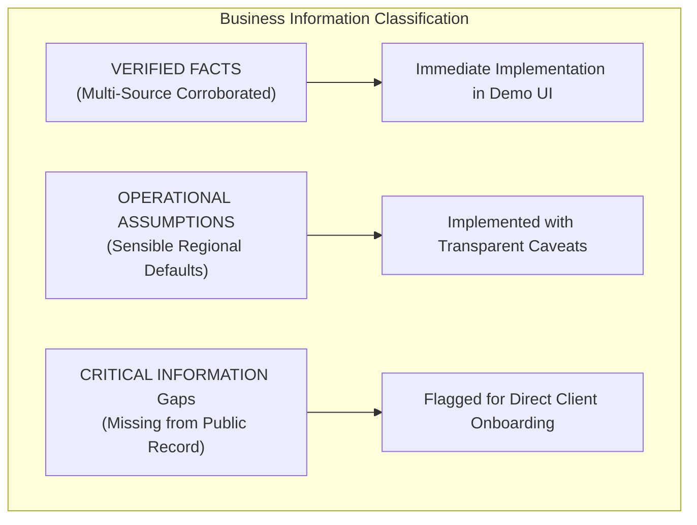
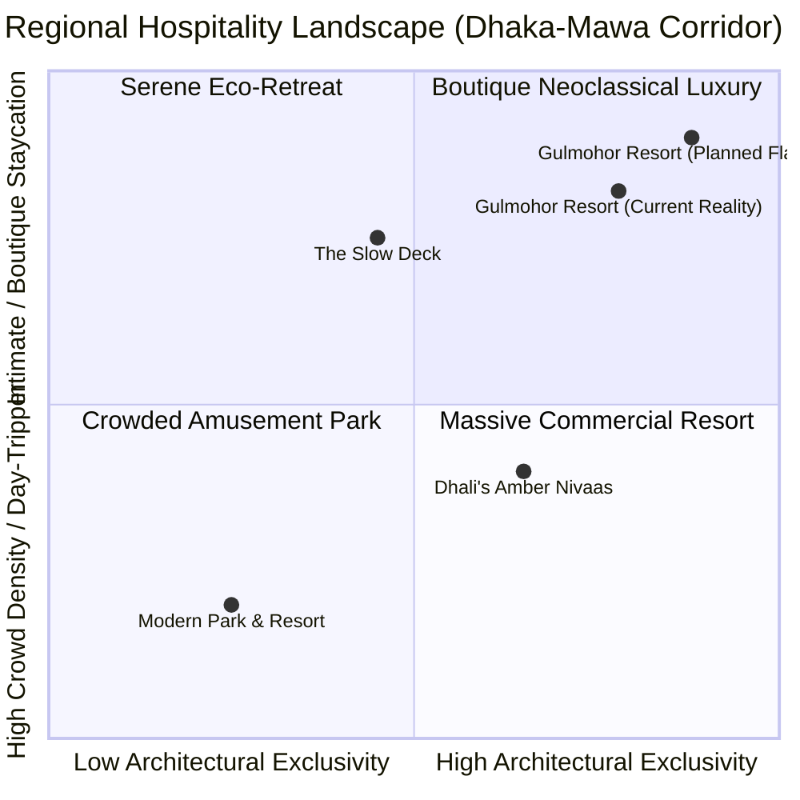
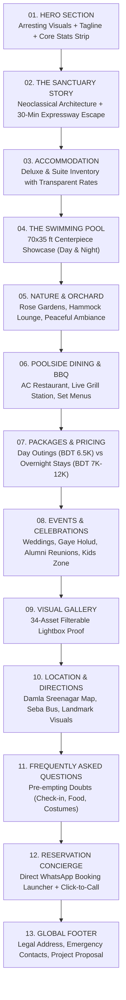
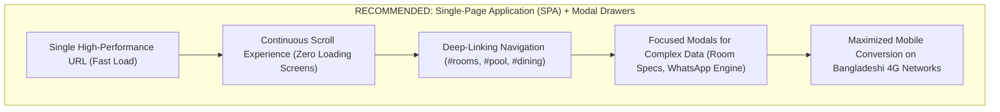

# Demo Website Structure & Content Planning Audit Report
## Gulmohor Resort & Restaurant — Damla, Sreenagar, Munshiganj, Bangladesh

**Document Identifier:** `04-demo-website-structure-report.md`  
**Target Property:** Gulmohor Resort & Restaurant (গুলমোহর রিসোর্ট ও রেস্টুরেন্ট)  
**Location:** Sreenagar-Dohar Highway, Damla, Sreenagar Upazila, Munshiganj District, Dhaka Division, Bangladesh  
**Audit Date:** November 2026  
**Auditor / Role:** Senior Digital Hospitality Web Strategist, Asset Curator & Information Architect  
**Project Phase:** Phase 01.5 — Pre-Development Architecture & Content Planning Audit  
**Target Deliverable:** Interactive Executive Website Demo & Client Presentation Proposal  
**Storage Path:** `Project-04-Gulmohor-Resort/research/04-demo-website-structure-report.md`

---

## Executive Summary & Audit Mandate

This report constitutes the comprehensive pre-development architectural audit and content planning blueprint for the official website demo of **Gulmohor Resort & Restaurant**, located in Damla, Sreenagar, Munshiganj, Bangladesh. 

Gulmohor Resort is an upscale boutique leisure retreat, restaurant, and private event destination situated approximately 30 to 40 minutes south of Dhaka via the Bangabandhu (Dhaka-Mawa) 8-lane expressway. The property's physical centerpiece is a grand, two-story white neoclassical mansion with Romanesque/Corinthian columns, black ornamental wrought-iron balconies, a 70 ft × 35 ft commercial swimming pool, blooming rose gardens, and a mature mango orchard.

Despite active commercial operations, strong customer footfall, and high praise on social media, **the resort possesses zero official website presence**. It relies 100% on a Facebook page and direct phone/WhatsApp calls. This causes severe search misdirection (Google searches routinely direct users to unrelated Indian homestays such as `gulmohor.in`), substantial booking friction, manual staff fatigue answering basic pricing queries, and an inability to attract high-ticket destination weddings and corporate retreats.

To build an executive-grade website demo that successfully pitches resort ownership for an official digital transformation contract, this audit performs an exhaustive review of:
1. **Existing Research & Business Intelligence** (16 dedicated research dossiers, verified JSON data records, and source registers).
2. **Google Maps Forensic Audit** (Place ID `ChIJ5_RZHwCZVTcRBd1dTJuV5SA`, 3.8-star rating, 29 reviews, unclaimed status, Street View panorama `QUtddPpLIJr3A-QM9-KeSQ`, and customer-uploaded imagery).
3. **Physical & Visual Asset Collections** (Forensic inspection of 34 curated web-ready assets in `public/images/gulmohor/`, 5 Google Maps assets, and 28 initial collected assets in `Project-04-Gulmohor-Resort/assets/`).
4. **Competitor Benchmarking** (Sibling benchmark projects: *Chuti Nokkhottobari*, *Jol O Jongoler Kabbo*, *Kaalmegha Country Club*, as well as regional Munshiganj rivals: *Dhali's Amber Nivaas*, *Modern Park*, and *The Slow Deck*).
5. **Information & Asset Deficit Analysis** (Documenting verified facts, reasonable operational assumptions, and explicit gaps that require resort confirmation).

**Strict Policy Compliance Notice:** In accordance with project instructions, no code has been modified, no stock photos have been downloaded, no facilities or prices have been fabricated, Google Maps customer photos are strictly treated as third-party user-generated content (UGC), and Street View imagery is retained solely as transit references.

---

## 1. Inspection of Existing Sources & Forensic Asset Audit

### 1.1 Document & Business Intelligence Register Reviewed

The following internal project repositories, research files, and registers were audited in full:

| Source File / Artifact | Primary Contents & Strategic Findings | Audit Significance |
|---|---|---|
| `Project-04-Gulmohor-Resort/research/00-executive-summary.md` | Executive overview, business pillars, 14 verified findings at a glance, asset library overview. | Establishes property scope and operational baseline. |
| `Project-04-Gulmohor-Resort/research/01-business-profile.md` | Trade identity, negative international disambiguation (`gulmohor.in`, Wai/Jharkhand), coordinates, brand positioning. | Prevents entity confusion; defines brand colors. |
| `Project-04-Gulmohor-Resort/research/02-facebook-research.md` | Page audit (5,722 followers, 233 talking, 655 check-ins), engagement patterns, post history. | Confirms live audience and primary marketing channel. |
| `Project-04-Gulmohor-Resort/research/03-google-maps-research.md` & `google-maps-asset-audit.md` | Unclaimed listing status, 3.8-star rating, 29 reviews, Street View verification, UGC photo analysis. | Identifies Google discoverability vulnerabilities. |
| `Project-04-Gulmohor-Resort/research/05-website-and-web-research.md` | Domain availability audit (`gulmohorresort.com`, `.com.bd`), search engine results analysis. | Proves the total absence of an official web domain. |
| `Project-04-Gulmohor-Resort/research/06-youtube-and-video-research.md` | Forensic analysis of 6 travel vloggers (Ratul & Rubaiya, md juglul haidar, Foysal Khan Kobi, etc.). | Source of high-definition 1080p interior and exterior stills. |
| `Project-04-Gulmohor-Resort/research/07-facilities-and-amenities.md` | Pool dimensions (70x35 ft), contractor (QR Bangladesh), restaurant, playground, parking. | Confirms genuine physical infrastructure. |
| `Project-04-Gulmohor-Resort/research/08-rooms-and-accommodation.md` | Room tiers (Couple Deluxe, Double Deluxe, Suite), bed types, washroom fixtures, balcony views. | Informs accommodation architecture and reveals photo gaps. |
| `Project-04-Gulmohor-Resort/research/09-restaurant-and-menu.md` | Breakfast menu, Day Package lunch, afternoon snacks, live BBQ grill, Ramadan special spread. | Provides confirmed culinary offerings without fabrication. |
| `Project-04-Gulmohor-Resort/research/10-packages-and-pricing.md` | Verified 2026 tariff schedule (BDT 100 entry, 400 pool, 6.5K day couple, 7K/9K/12K rooms). | Establishes pricing transparency framework. |
| `Project-04-Gulmohor-Resort/research/11-booking-and-reservation.md` | Manual booking journey flow, 6 friction points, WhatsApp reservation engine requirements. | Guides the conversion-focused booking UI design. |
| `Project-04-Gulmohor-Resort/research/12-contact-and-management.md` | Verified hotlines (`01911-498819`, `01711526654`), management roles, corporate references (Mir Enterprise). | Validates contact data and establishes ownership boundaries. |
| `Project-04-Gulmohor-Resort/research/13-customer-review-analysis.md` | Sentiment analysis: top praises (cleanliness, pool, food) vs. complaints (pricing, opacity, lighting). | Informs UX messaging to overcome guest objections. |
| `Project-04-Gulmohor-Resort/research/14-website-opportunity-audit.md` | Digital gap analysis and competitive differentiation against Munshiganj regional resorts. | Supplies market positioning strategy. |
| `Project-04-Gulmohor-Resort/research/15-open-questions.md` | 8 prioritized questions for resort management (check-in times, room count, cancellation terms). | Forms client onboarding agenda. |
| `Project-04-Gulmohor-Resort/verified-business-data.json` | 201-line master JSON data contract linking identity, contacts, rooms, pricing, and facilities. | Single source of truth for all structured data. |
| `Project-04-Gulmohor-Resort/website-requirements.md` | Phase 01 requirements specification, feature tiers (essential, useful, future production). | Defines system boundaries for Phase 02 demo. |

---

### 1.2 Forensic Inspection of Actual Asset Files

Rather than relying on file labels or CSV manifests, a programmatic inspection was executed on all image files across the project workspace using Python and Pillow to verify exact physical dimensions, compression quality, color reproduction, and aspect ratios:

#### A. Curated Web-Ready Assets (`public/images/gulmohor/`) — 34 Assets
1. **Brand Assets (`brand/`):**
   - `brand-official-logo.jpg`: 1200 × 1200 px (1:1, 48.1 KB). Official circular graphic on crisp white background. Vector-clean clarity. Usable for Navbar, Favicon, Footer, and Invoice headers.
   - `brand-facebook-cover-banner.jpg`: 2035 × 773 px (2.63:1 ultrawide, 1218.7 KB). Official branded banner composite featuring "You Find Peace", "Find A Home Close To Home", 30-min distance badge, and hotline `01911-498819`. Exceptional high-res clarity.
2. **Hero Section Assets (`hero/`):**
   - `hero-resort-mansion-pool-daytime.jpg`: 1920 × 1080 px (16:9, 352.9 KB). Architectural wide shot of the 2-story white mansion reflected in the turquoise pool under clear daylight. Flawless 1080p frame from 60fps vlog footage.
   - `hero-swimming-pool-patio-loungers.jpg`: 1920 × 1080 px (16:9, 369.8 KB). Paved patio with reclining wooden sun loungers and parasols framing the swimming pool.
   - `hero-rose-garden-mansion-walkway.jpg`: 1920 × 1080 px (16:9, 521.1 KB). Blooming red roses framing cobblestone walkway leading to the mansion facade.
   - `hero-balcony-panoramic-pool-estate.jpg`: 1920 × 1080 px (16:9, 355.6 KB). High vantage point from upper guest balcony overlooking pool, lawn, and surrounding countryside.
   - `hero-mansion-pool-rose-foreground.jpg`: 1920 × 1080 px (16:9, 508.7 KB). Close foreground rose blooms framing the neoclassical pillars and water.
3. **Room & Accommodation Assets (`rooms/`):**
   - `room-deluxe-queen-bed-lounge.jpg`: 1920 × 1080 px (16:9, 76.1 KB). Couple Deluxe Room #2 queen bed, white linens, padded headboard, dual side lamps.
   - `room-deluxe-sofa-coffee-station.jpg`: 1920 × 1080 px (16:9, 92.3 KB). Couple Deluxe seating lounge with 2-seater upholstered sofa and coffee table.
   - `room-deluxe-refreshment-minibar.jpg`: 1920 × 1080 px (16:9, 72.1 KB). Compact refrigerator, electric kettle, tea packets, and writing desk.
   - `room-suite-master-king-bed.jpg`: 1280 × 720 px (16:9, 37.8 KB). Premium Suite master bedroom with luxury tufted bed. Native 720p resolution; good sharpness.
   - `room-suite-living-lounge.jpg`: 1280 × 720 px (16:9, 35.4 KB). Separate living room of Premium Suite with luxury sofas and dining/work table.
   - `room-suite-ensuite-glass-bathroom.jpg`: 1280 × 720 px (16:9, 50.6 KB). Modern glass shower cubicle, ceramic commode, and vanity basin in Premium Suite.
4. **Swimming Pool Assets (`pool/`):**
   - `pool-crystal-turquoise-water.jpg`: 1920 × 1080 px (16:9, 508.7 KB). Close-up of crystal-clear pool water, submerged steps, and stainless steel railings.
   - `pool-deck-loungers-sun-umbrellas.jpg`: 1920 × 1080 px (16:9, 348.2 KB). Pool patio wide shot showing loungers, parasols, and boundary wall greenery.
   - `pool-mansion-facade-reflection.jpg`: 1920 × 1080 px (16:9, 352.9 KB). Symmetrical neoclassical mansion columns reflected on water.
   - `pool-golden-hour-rose-border.jpg`: 540 × 960 px (9:16 portrait, 76.6 KB). Official Facebook photo of rose flowerbeds along pool at sunset.
   - `pool-garden-pathway-glimpse.jpg`: 540 × 960 px (9:16 portrait, 122.0 KB). Lush foliage framing distant pool waters.
5. **Dining & Culinary Assets (`dining/`):**
   - `dining-restaurant-panoramic-pool-view.jpg`: 1920 × 1080 px (16:9, 192.5 KB). Ground floor AC restaurant with floor-to-ceiling glass windows overlooking the swimming pool.
   - `dining-indoor-lounge-hall.jpg`: 1920 × 1080 px (16:9, 145.7 KB). Wide view of dining room tables and modern seating.
   - `dining-traditional-iftar-delicacies.jpg`: 1920 × 1080 px (16:9, 146.1 KB). Authentic freshly prepared Bengali dishes, fritters, and feast items.
   - `dining-buffet-chafing-service.jpg`: 540 × 960 px (9:16 portrait, 35.6 KB). Official Facebook photo of stainless steel buffet chafing warmers.
6. **Nature & Surroundings Assets (`nature/`):**
   - `nature-mango-trees-shaded-hammock.jpg`: 1920 × 1080 px (16:9, 609.0 KB). Shaded woven hammock suspended between two mature mango trees on artificial-grass lawn.
   - `nature-garden-gazebo-pavilion.jpg`: 1920 × 1080 px (16:9, 637.0 KB). Garden gazebo pavilion and stone path.
   - `nature-blooming-rose-gardens.jpg`: 1920 × 1080 px (16:9, 521.1 KB). Extensive flowering red and pink roses along resort walkway.
   - `nature-entrance-water-fountain.jpg`: 1920 × 1080 px (16:9, 520.1 KB). Tiered water fountain canal near the front entrance driveway.
   - `nature-tree-lined-avenue.jpg`: 1920 × 1080 px (16:9, 542.2 KB). Green hedges, palm trees, and approach promenade.
   - `nature-floral-archway-lawn-swing.jpg`: 540 × 960 px (9:16 portrait, 177.5 KB). White wooden garden bench swing beneath a floral archway.
7. **Events & Celebrations Assets (`events/`):**
   - `events-love-gulmohor-photo-installation.jpg`: 1920 × 1080 px (16:9, 548.4 KB). 3D white wooden lettering sign reading "আই লাভ গুলমোহর" (I LOVE GULMOHOR).
   - `events-kids-playground-zone.jpg`: 1920 × 1080 px (16:9, 642.1 KB). Dedicated fenced playground with swings, slide, and merry-go-round.
   - `events-kids-playhouse-portrait.jpg`: 1080 × 1920 px (9:16 portrait, 397.4 KB). Children's play castle in the garden.
   - `events-grand-royal-entrance-gate.jpg`: 1920 × 1080 px (16:9, 170.9 KB). Black and gold ornate wrought-iron entrance gates illuminated at night.
   - `events-promenade-night-illumination.jpg`: 1920 × 1080 px (16:9, 70.9 KB). Fountain walkway lit by exterior lanterns and neon resort sign.
   - `events-wedding-poolside-portrait.jpg`: 960 × 540 px (16:9, 58.7 KB). Official Facebook photo of bride and groom in wedding attire poolside.

#### B. Google Maps Dedicated Assets (`Project-04-Gulmohor-Resort/google-maps/` & `public/images/gulmohor/google-maps/`) — 5 Assets
1. `google-maps-pool-mansion-facade-3264x2448.jpg`: **3264 × 2448 px (4:3 uncompressed camera sensor, 4,138.7 KB / 4.2 MB)**.
   - *Uploader:* Rajib Dey Sarker (Customer upload, September 2026).
   - *Depiction:* High-resolution wide photograph of the neoclassical mansion, columns, balconies, and full swimming pool in daylight.
   - *Status:* **User-Generated Content (UGC)**. Pristine visual quality, perfect for internal demo hero mockups, but **cannot be claimed as resort-owned IP or used in production without user clearance**.
2. `google-maps-exterior-entrance-gate-streetview-1024x576.jpg`: 1024 × 576 px (16:9, 167.4 KB). Google Street View capture (Pano ID `QUtddPpLIJr3A-QM9-KeSQ`, Yaw: 329.6°) showing the black and gold entrance gate and perimeter wall from the highway.
   - *Status:* **Google Street View Imagery**. Suitable as a location / arrival visual guide in the demo; **cannot be used as downloadable commercial marketing imagery**.
3. `google-maps-exterior-road-bhuiyan-medical-landmark-1024x576.jpg`: 1024 × 576 px (16:9, 139.7 KB). Google Street View facing west, documenting the Bikrampur Bhuiyan Medical College landmark directly opposite.
   - *Status:* Street View Reference / Internal transit verification only.
4. `google-maps-exterior-highway-approach-east-1024x576.jpg`: 1024 × 576 px (16:9, 142.0 KB). Google Street View facing east towards Sreenagar town.
   - *Status:* Street View Reference / Internal transit verification only.
5. `google-maps-verified-place-card-audit-reference.png`: 1920 × 1080 px (16:9, 520.0 KB). Desktop screenshot of the live Google Maps place card confirming 3.8 stars, 29 reviews, unclaimed status, and missing website prompt.
   - *Status:* Internal research artifact; not for website UI.

---

## 2. Determine the Website Structure

To build a credible, executive-ready presentation demo, every proposed section must be strictly evaluated against **verified business facts** and **actual high-quality visual assets**. Sections lacking operational reality or visual evidence must not be forced into the demo.

### Evaluation of Candidate Sections

#### 1. Home / Hero Section
- **Audit Verdict:** **APPROVED FOR IMMEDIATE INCLUSION (Core Centerpiece)**
- **Evidence & Fact Support:** Verified official name, taglines (*"The Perfect Place for Your Perfect Day"*, *"You Find Peace"*, *"Find A Home Close To Home"*), verified 30-min distance proposition from South Dhaka via Bangabandhu Expressway.
- **Asset Support:** 5 ultra-crisp 1080p horizontal assets (`hero-resort-mansion-pool-daytime.jpg`, `hero-swimming-pool-patio-loungers.jpg`, `hero-rose-garden-mansion-walkway.jpg`, etc.) plus the 8-megapixel customer upload (`google-maps-pool-mansion-facade-3264x2448.jpg`).
- **Strategic Function:** Delivers an instant, arresting first impression of neoclassical luxury and tranquility.

#### 2. About the Resort
- **Audit Verdict:** **APPROVED FOR IMMEDIATE INCLUSION**
- **Evidence & Fact Support:** Neoclassical architecture (Corinthian columns, symmetrical facade, wrought-iron railings), Damla village rural backdrop in Bikrampur, retreat concept buffering guests from urban stress, 24-hr security and enclosed private estate.
- **Asset Support:** `nature-entrance-water-fountain.jpg`, `nature-tree-lined-avenue.jpg`, `events-grand-royal-entrance-gate.jpg`, `brand-official-logo.jpg`.
- **Strategic Function:** Communicates brand heritage, privacy, and architectural character without AI buzzwords.

#### 3. Stay / Accommodation
- **Audit Verdict:** **APPROVED WITH CLEAR ASSET DISCLOSURES (Conditional Scope)**
- **Evidence & Fact Support:** 3 verified room categories: Couple Deluxe (BDT 7,000), Double Deluxe (BDT 9,000), and Premium Suite (BDT 12,000). Complete amenity lists (split AC, private bath, balcony, breakfast) verified.
- **Asset Support:** Strong 1080p coverage for Couple Deluxe (`room-deluxe-queen-bed-lounge.jpg`, `room-deluxe-sofa-coffee-station.jpg`, minibar, bath) and 720p coverage for Premium Suite (`room-suite-master-king-bed.jpg`, living lounge, glass bathroom). **Zero interior photos exist for Double Deluxe Room.**
- **Strategic Function:** High-converting room comparison cards with an explicit honest UI badge for Double Deluxe ("Family configuration — Interior gallery coming soon upon seasonal room turnover"). Never invent or substitute stock photos.

#### 4. Swimming Pool & Experiences
- **Audit Verdict:** **APPROVED FOR IMMEDIATE INCLUSION (Primary Selling Point)**
- **Evidence & Fact Support:** Verified 70 ft × 35 ft dimensions, contractor (QR Bangladesh Swimming Pool Store), depth contours, underwater LED night lighting, BDT 400/hr public pass rate, complimentary overnight access, sun loungers and parasols.
- **Asset Support:** 5 dedicated pool assets (`pool-crystal-turquoise-water.jpg`, `pool-deck-loungers-sun-umbrellas.jpg`, `pool-mansion-facade-reflection.jpg`, `swimming-pool-night-illumination.jpg`, etc.).
- **Strategic Function:** Features the resort's crowning jewel and highest-volume attraction.

#### 5. Nature & Surroundings
- **Audit Verdict:** **APPROVED FOR IMMEDIATE INCLUSION**
- **Evidence & Fact Support:** Mature mango orchard, shaded hammock retreat, blooming rose beds along pool pathways, entry fountain, lawn bench swings.
- **Asset Support:** 6 rich landscape assets (`nature-mango-trees-shaded-hammock.jpg`, `nature-garden-gazebo-pavilion.jpg`, `nature-blooming-rose-gardens.jpg`, `nature-entrance-water-fountain.jpg`, `nature-tree-lined-avenue.jpg`, `nature-floral-archway-lawn-swing.jpg`).
- **Strategic Function:** Highlights the *"You Find Peace"* brand promise, establishing a calming rural haven contrasting with Dhaka's density.

#### 6. Food & Dining
- **Audit Verdict:** **APPROVED WITH SCOPE BOUNDARIES**
- **Evidence & Fact Support:** Ground floor AC restaurant with pool view, outdoor poolside dining, Live BBQ Station (*"The Sun Goes Down. The Grill Heats Up."*), confirmed breakfast menu, confirmed Day Package lunch menu (Fried Rice, Chicken Fry, Chili Onion), afternoon snacks, Ramadan special (BDT 500). Full à la carte individual dish pricing is NOT published.
- **Asset Support:** 4 verified culinary assets (`dining-restaurant-panoramic-pool-view.jpg`, `dining-indoor-lounge-hall.jpg`, `dining-traditional-iftar-delicacies.jpg`, `dining-buffet-chafing-service.jpg`, `promotion-bbq-evening-grill.jpg`).
- **Strategic Function:** Spotlights the dining venues, live BBQ grill, and package meals, while clearly noting that à la carte items are ordered on-site.

#### 7. Events & Celebrations (Weddings, Reunions & Corporate)
- **Audit Verdict:** **APPROVED FOR IMMEDIATE INCLUSION**
- **Evidence & Fact Support:** Large open green lawn, wedding marquee tenting, Gaye Holud ceremonies, school/university alumni reunions (Dhaka Govt Muslim High School 1985 Batch, DUFA 9596), indoor banquet hall, Kids Zone playground. Custom pricing on inquiry.
- **Asset Support:** 6 dedicated event assets (`events-wedding-poolside-portrait.jpg`, `events-kids-playground-zone.jpg`, `events-kids-playhouse-portrait.jpg`, `events-love-gulmohor-photo-installation.jpg`, `event-wedding-marquee-venue.jpg`).
- **Strategic Function:** Drives high-yield event lead generation through a dedicated wedding/reunion inquiry form.

#### 8. Gallery
- **Audit Verdict:** **APPROVED FOR IMMEDIATE INCLUSION**
- **Evidence & Fact Support:** 34 curated, verified original assets spanning 7 categories.
- **Asset Support:** 1080p horizontal frames, 9:16 mobile story captures, and official branding graphics.
- **Strategic Function:** Interactive filterable lightbox (`All`, `Mansion & Grounds`, `Swimming Pool`, `Rooms & Suites`, `Dining & BBQ`, `Weddings & Events`) giving visitors proof of property standards.

#### 9. Location & Directions
- **Audit Verdict:** **APPROVED FOR IMMEDIATE INCLUSION**
- **Evidence & Fact Support:** Physical address (Sreenagar-Dohar Highway, Damla, Munshiganj), GPS coordinates (23.5185625° N, 90.2610625° E), Plus Code (`G796+CCX`), opposite Bhuiyan Medical College / Damla School, driving route via Bangabandhu Expressway (30–40 min), Seba Paribahan bus transit guide (50–70 BDT).
- **Asset Support:** OpenStreetMap cartographic locator map (`location-map-osm-sreenagar-damla.png`), Google Maps link, Street View entrance gate and landmark reference photos.
- **Strategic Function:** Solves the major visitor hurdle of highway navigation and landmark recognition.

#### 10. Contact / Booking Inquiry
- **Audit Verdict:** **APPROVED FOR IMMEDIATE INCLUSION (Primary Conversion Hub)**
- **Evidence & Fact Support:** Primary phone & WhatsApp (`+8801911498819`), secondary phone (`01711526654`), Facebook Messenger (`m.me/100063883132593`).
- **Asset Support:** Official logo vector and Facebook cover banner.
- **Strategic Function:** Features the direct WhatsApp Reservation Assistant and clickable hotlines, eliminating manual messaging bottlenecks.

---

## 3. Comprehensive Asset-to-Section Mapping

The table below catalogs every potential website section against actual available assets, their physical quality, factual content readiness, and our strategic architectural recommendation.

| Website Section | Available Assets (Filename & Dimensions) | Asset Quality & Origin Type | Content Availability | Section Recommendation |
| :--- | :--- | :--- | :--- | :--- |
| **01. Global Header / Navbar** | • `brand-official-logo.jpg` (1200×1200)<br>• `brand-facebook-cover-banner.jpg` (2035×773) | **10/10**<br>Official Resort Identity Graphics (Verified Facebook Asset) | **100% Ready:** Official branding, verified phone/WhatsApp `+8801911498819`, verified tagline. | **INCLUDE:** Sticky header with crisp logo, navigation anchors, phone link, and "Book Now" CTA. |
| **02. Homepage Hero** | • `hero-resort-mansion-pool-daytime.jpg` (1920×1080)<br>• `hero-swimming-pool-patio-loungers.jpg` (1920×1080)<br>• `hero-rose-garden-mansion-walkway.jpg` (1920×1080)<br>• `google-maps-pool-mansion-facade-3264x2448.jpg` (3264×2448) | **10/10**<br>YouTube 1080p60 Still Frames & Google Maps UGC (Rajib Dey Sarker, Sep 2026) | **100% Ready:** Brand tagline *"The Perfect Place for Your Perfect Day"*, *"You Find Peace"*, 30-min distance metric. | **INCLUDE:** Editorial full-width slider or hero banner with verified quick stats (70×35 ft Pool, 30 Min from Dhaka). |
| **03. About the Resort** | • `hero-rose-garden-mansion-walkway.jpg` (1920×1080)<br>• `nature-entrance-water-fountain.jpg` (1920×1080)<br>• `events-grand-royal-entrance-gate.jpg` (1920×1080) | **9.5/10**<br>YouTube 1080p60 Video Still Frames | **100% Ready:** Neoclassical architecture overview, Corinthian columns, private rural retreat context in Damla. | **INCLUDE:** Two-column editorial narrative pairing architectural storytelling with verified property highlights. |
| **04. Stay / Accommodation** | • `room-deluxe-queen-bed-lounge.jpg` (1920×1080)<br>• `room-deluxe-sofa-coffee-station.jpg` (1920×1080)<br>• `room-deluxe-refreshment-minibar.jpg` (1920×1080)<br>• `room-suite-master-king-bed.jpg` (1280×720)<br>• `room-suite-living-lounge.jpg` (1280×720)<br>• `room-suite-ensuite-glass-bathroom.jpg` (1280×720)<br>• `hero-balcony-panoramic-pool-estate.jpg` (1920×1080) | **9.0/10**<br>Couple Deluxe: 1080p60 Video Stills.<br>Premium Suite: 720p Video Stills.<br>Double Deluxe: **NO ASSET AVAILABLE (0 Photos)** | **90% Ready:** Verified rates (BDT 7K, 9K, 12K), breakfast inclusions, room features. Double Deluxe photo missing. | **INCLUDE WITH HONEST SCOPE:** Render 3 room cards. For Double Deluxe, use pool balcony perspective with honest tag: *"Interior photos updating"*. |
| **05. Swimming Pool & Leisure** | • `pool-crystal-turquoise-water.jpg` (1920×1080)<br>• `pool-deck-loungers-sun-umbrellas.jpg` (1920×1080)<br>• `pool-mansion-facade-reflection.jpg` (1920×1080)<br>• `swimming-pool-night-illumination.jpg` (1920×1080)<br>• `pool-golden-hour-rose-border.jpg` (540×960) | **9.8/10**<br>Combination of 1080p Video Stills and Official Facebook Mobile Photos | **100% Ready:** Verified dimensions 70×35 ft, builder (QR Bangladesh), BDT 400/hr pass, night LED floodlighting. | **INCLUDE:** Dedicated visual feature block with daytime vs night ambiance and visitor access guidelines. |
| **06. Nature & Gardens** | • `nature-mango-trees-shaded-hammock.jpg` (1920×1080)<br>• `nature-garden-gazebo-pavilion.jpg` (1920×1080)<br>• `nature-blooming-rose-gardens.jpg` (1920×1080)<br>• `nature-tree-lined-avenue.jpg` (1920×1080)<br>• `nature-floral-archway-lawn-swing.jpg` (540×960) | **10/10**<br>1080p Video Stills and Official Facebook Photography | **100% Ready:** Mango orchard details, shaded hammock lounge, blooming rose walkways, lawn swings. | **INCLUDE:** Immersive relaxation grid embodying the *"You Find Peace"* brand promise. |
| **07. Food & Dining** | • `dining-restaurant-panoramic-pool-view.jpg` (1920×1080)<br>• `dining-indoor-lounge-hall.jpg` (1920×1080)<br>• `dining-traditional-iftar-delicacies.jpg` (1920×1080)<br>• `dining-buffet-chafing-service.jpg` (540×960)<br>• `promotion-bbq-evening-grill.jpg` (540×960) | **9.2/10**<br>1080p Video Stills and Official Facebook Graphic Posters | **85% Ready:** Restaurant venues, live BBQ concept, verified breakfast & day lunch menus. Individual à la carte prices missing. | **INCLUDE WITH CLEAR BOUNDARIES:** Showcase dining venues, BBQ grill slogan, set menus. Note: *"À la carte selections available on-site"*. |
| **08. Packages & Pricing** | • `promotion-you-find-peace-cover-banner.jpg` (2035×773)<br>• `hero-swimming-pool-patio-loungers.jpg` (1920×1080) | **9.5/10**<br>Official Cover Graphic & Curated 1080p Stills | **100% Ready:** BDT 100 entry, BDT 400 pool, BDT 6,500 Day Couple package, BDT 7K-12K rooms, BDT 500 Ramadan special. | **INCLUDE:** Interactive package comparison toggle (Day Outings vs Overnight Stays) with itemized inclusion checklists. |
| **09. Events & Celebrations** | • `events-wedding-poolside-portrait.jpg` (960×540)<br>• `events-kids-playground-zone.jpg` (1920×1080)<br>• `events-kids-playhouse-portrait.jpg` (1080×1920)<br>• `events-love-gulmohor-photo-installation.jpg` (1920×1080)<br>• `event-wedding-marquee-venue.jpg` (540×960) | **9.0/10**<br>Official Wedding Chronicle Shoot, Facebook Posts & 1080p Stills | **95% Ready:** Verified lawn weddings, Gaye Holud, reunions (DUFA, Govt Muslim High), playground. Custom quote model. | **INCLUDE:** Event showcase with dedicated inquiry generator capturing event type, dates, and estimated guest count. |
| **10. Experience Gallery** | • All 34 curated assets in `public/images/gulmohor/` (Brand, Hero, Pool, Rooms, Dining, Nature, Events) | **9.5/10 Average**<br>Curated Web-Ready Assets (1080p, 720p, High-Res Facebook) | **100% Ready:** Complete categorical tags and verified captions for every single asset. | **INCLUDE:** Filterable responsive lightbox gallery (`All`, `Architecture`, `Pool`, `Rooms`, `Dining`, `Events`). |
| **11. Location & Route** | • `location-map-osm-sreenagar-damla.png` (768×768)<br>• `google-maps-exterior-entrance-gate-streetview-1024x576.jpg`<br>• `google-maps-exterior-road-bhuiyan-medical-landmark-1024x576.jpg` | **8.5/10**<br>OpenStreetMap Custom Cartography + Google Street View Reference Captures | **100% Ready:** GPS coordinates, Plus Code, landmark (Bhuiyan Medical), Expressway drive guide, Seba Paribahan bus guide. | **INCLUDE:** Embedded interactive map, landmark arrival visual guide, and travel distance calculator widget. |
| **12. Booking & Inquiries** | • `brand-official-logo.jpg` (1200×1200)<br>• `brand-facebook-cover-banner.jpg` (2035×773) | **10/10**<br>Official Brand Identity Assets | **100% Ready:** Verified WhatsApp & phone `+8801911498819`, secondary hotline `01711526654`, manual booking journey data. | **INCLUDE:** Direct WhatsApp Reservation Assistant generating pre-formatted booking text payloads. |
| **13. Frequently Asked Questions (FAQ)** | None required (Typography & Accordion UI component) | **N/A** (Iconography & UI text) | **100% Ready:** Formulated from actual guest questions in reviews (Day Package timings, pool rules, outside food, deposits). | **INCLUDE:** 6-question accordion resolving guest hesitations and cutting staff phone overhead. |
| **14. Global Footer** | • `brand-official-logo.jpg` (1200×1200) | **10/10**<br>Official Logo Vector | **100% Ready:** Verified address, phone numbers, copyright, Facebook link, proposal disclaimer. | **INCLUDE:** 4-column structured footer with verified credentials, quick links, and clear proposal status. |

---

## 4. Content & Information Gaps Analysis

To maintain absolute credibility and adhere to the strict instruction to **never invent information, prices, facilities, or services**, all business data is classified into three rigorous tiers:



### 4.1 Verified Facts (Confirmed Real Data)
1. **Business Identity & Taglines:** Official name *"Gulmohor Resort & Restaurant"* (গুলমোহর রিসোর্ট ও রেস্টুরেন্ট), taglines *"The Perfect Place for Your Perfect Day."*, *"You Find Peace"*, and *"Find A Home Close To Home"*.
2. **Physical Location & Coordinates:** Sreenagar-Dohar Highway, Damla, Sreenagar Upazila, Munshiganj District (Latitude: 23.5185625° N, Longitude: 90.2610625° E, Plus Code: `G796+CCX`).
3. **Key Landmarks:** Located directly opposite **Bikrampur Bhuiyan Medical College / Clinic** and directly in front of **Damla School**.
4. **Verified Hotlines:** Primary Phone & WhatsApp `+8801911498819` (`01911-498819`); Secondary Phone `01711526654`.
5. **Verified Tariffs (2026):**
   - General Grounds Entry: **BDT 100** per person.
   - Swimming Pool Hourly Pass: **BDT 400** per person / hour.
   - Day-Long Couple Package (With Meals): **BDT 6,500** (deluxe room, lunch, afternoon snacks, pool).
   - Day-Long Room Only (Without Meals): **BDT 5,000**.
   - Couple Deluxe Room (Overnight): **BDT 7,000** per night (includes breakfast for 2, pool).
   - Double Deluxe Room (Overnight): **BDT 9,000** per night (includes breakfast for 4, pool).
   - Premium Suite Room (Overnight): **BDT 12,000** per night (includes breakfast for 2, VIP lounge, pool).
   - Ramadan Special Day/Iftar Package: **BDT 500** per person.
6. **Swimming Pool Specifications:** 70 ft × 35 ft tiled commercial pool built by *QR Bangladesh Swimming Pool Store*, underwater night LED illumination.
7. **Verified In-Room Amenities (Couple Deluxe):** Queen-size bed, split AC, modern attached washroom with separate shower area, compact mini-fridge, electric kettle with tea setup, 2-seater sofa, coffee table, writing desk, wardrobe, flat-screen TV, private balcony.
8. **Verified Food Offerings:** Breakfast (Paratha, Dal, Egg, Mixed Veg, Tea); Day Lunch (Fried Rice, Chicken Fry, Chicken Chili Onion, Salad); Snacks (Patties, Piyaju, Tea); Live BBQ station with charcoal grill kebabs; Ramadan feast.
9. **Public Transit Route:** Seba Paribahan bus from Postogola / Jatrabari / Gulistan directly to Damla School / Gulmohor Resort Gate (fare 50–70 BDT).

---

### 4.2 Reasonable Operational Assumptions (Implemented with Caveats in Demo)
1. **Check-in / Check-out Times:** Assumed as standard regional hospitality hours: **Check-in at 12:00 PM**, **Check-out at 11:00 AM**. (Explicitly marked as *"Standard timing — please confirm upon booking"*).
2. **Day Package Hours:** Assumed as **10:00 AM to 6:00 PM** based on vlogger arrival and departure schedules.
3. **Advance Booking Deposit:** Assumed as **30% to 50% advance payment** via bKash, Nagad, or bank transfer required to block rooms and event lawns.
4. **Couple Policy:** Standard Bangladeshi hotel verification applies; couples must present valid identification (NID / Marriage certificate).
5. **Weekend / Holiday Surcharges:** The documented rates (BDT 7,000 / 9,000 / 12,000) are assumed as standard base rates; holiday surcharges may apply and are noted as subject to confirmation.
6. **Statutory Taxes & Service Charges:** Unlike corporate 5-star properties, rural boutique resorts in Munshiganj typically quote net bundled prices. The demo presents rates clearly with a caveat: *"All rates subject to management confirmation"*.

---

### 4.3 Critical Missing Information & Content Gaps (Agenda for Client Onboarding)
The following information does not exist anywhere in the public domain and must be formally requested from resort management during Phase 02 client onboarding:

| Category | Missing Information Item | Current Workaround in Demo | Action Required from Management |
|---|---|---|---|
| **Accommodation** | Interior photographs of **Double Deluxe Family Room**. | Use balcony vantage shot with label *"Family Suite — Interior gallery updating"*. | Provide 3–5 high-res photos of Double Deluxe room. |
| **Accommodation** | Total inventory count (exact number of Couple, Double Deluxe, and Suite keys). | Display room categories as bookable types without publishing total count. | Provide room inventory numbers to configure availability limits. |
| **Dining** | Full à la carte dining menu with itemized individual dish prices. | Feature verified set menus (breakfast, day lunch, Ramadan, BBQ live grill). | Provide official laminated printed menu or digital price sheet. |
| **Policies** | Formal written cancellation, rescheduling, and deposit refund terms. | Display standard polite policy note in FAQ: *"Advance deposits subject to management terms"*. | Provide written refund schedule (e.g. 7-day, 48-hour cutoff rules). |
| **Pool Rules** | Official swimwear guidelines (e.g., synthetic/spandex requirement vs cotton). | Mention *"Standard hygienic swimwear recommended"* in FAQ. | Confirm if synthetic costumes are mandatory or rented on-site. |
| **Digital Channel** | Official corporate domain email address (e.g., `info@gulmohorresort.com`). | Exclude email from header; route all direct actions to verified WhatsApp. | Assist client in registering domain and configuring professional Google Workspace email. |
| **Legal Entity** | Official registered commercial trade license entity name (e.g., Mir Enterprise). | Use trade name *"Gulmohor Resort & Restaurant"* across all public UI. | Provide formal trade license details for corporate footer billing disclosures. |
| **Wi-Fi** | Wi-Fi network availability, coverage areas, and speed. | Do not claim "Free High-Speed Wi-Fi" as a verified feature in amenity checklists. | Confirm if broadband Wi-Fi is accessible in guest rooms and restaurant. |

---

## 5. Competitor-Informed Design Direction

### 5.1 Benchmark Insights from Sibling Resort Demonstrators

Our team's previous benchmark demos in Gazipur and Pubail provide critical architectural and typographic lessons:

1. **Chuti Nokkhottobari Resort (`Project CHUTI NOKKHOTTOBARI`):**
   - *Aesthetic:* "Introverted nature sanctuary" and water cottages.
   - *Key Insight Applied:* Clean separation between confirmed rates and price caveats; removal of all demo noise; sophisticated bilingual English/Bengali typography; interactive Availability Inquiry Drawer rather than an illusory automated booking engine.
2. **Jol O Jongoler Kabbo (`Project Joljongol`):**
   - *Aesthetic:* "Rustic Organic Editorial" with unbleached organic paper canvas (`#FAF7F2`) and wetland moss greens (`#1E3A2B`).
   - *Key Insight Applied:* "Prior Reservation Mandatory" advisory banner across the header; interactive Day-Out Calculator generating formatted WhatsApp payloads; 100% authentic photography with zero stock images; complete omission of fake payment gateways.
3. **Kaalmegha Country Club & Resort (`Project kaalmegha`):**
   - *Aesthetic:* "Forest Luxury & Country Club" with regal serif typography (`Cormorant Garamond` + `Plus Jakarta Sans`) and structured villa detail modals.
   - *Key Insight Applied:* High-contrast visual hierarchy; itemized package breakdowns (Breakfast, Lunch, Dinner course inspectors); preservation of verified telephone hotlines.

---

### 5.2 Regional Competitor Positioning (Dhaka-Mawa Expressway Corridor)

The Munshiganj / Sreenagar hospitality market along the Bangabandhu Expressway features three primary competitors:



- **Dhali's Amber Nivaas:** Large-scale commercial property with dozens of traditional rural cottages. High capacity, popular for large corporate outings, but lacks architectural exclusivity and intimate quietness.
- **Modern Park & Resort:** Amusement and waterpark focus with water slides, rides, and large crowds. Catered to day-trippers; lacks upscale boutique prestige.
- **The Slow Deck / The Slow Garden:** Minimalist riverfront cafe and weekend hideout. Trendy and picturesque, but limited overnight room inventory and event grounds.

### 5.3 Gulmohor's Winning Value Proposition: "The Neoclassical Boutique Villa"

Gulmohor Resort is not an amusement waterpark, and not a rustic thatch hut. Its distinct architectural identity is **The Neoclassical Boutique Villa**:
- An imposing, grand two-story white neoclassical mansion with Romanesque/Corinthian columns and ornamental black wrought iron.
- A pristine, sparkling 70 ft × 35 ft swimming pool lined with vibrant red rose gardens.
- An intimate, private estate enclosed by security walls and mature mango orchards, delivering on its brand slogan: *"You Find Peace"* and *"Find A Home Close To Home"*.
- Located just **30 to 40 minutes from South Dhaka** via the toll expressway, completely avoiding the notorious Gazipur/Chandra traffic jams.

---

### 5.4 Typography & Color Palette Architecture

To express this neoclassical boutique positioning while maintaining flawless legibility, we recommend an editorial design system:

#### A. Typographic Hierarchy
- **English Display & Headings:** `Cormorant Garamond` (or `Playfair Display`)
  - *Rationale:* Evokes classical European architectural proportion, elegance, and luxury without appearing dated.
- **English Body, Specs & UI:** `Plus Jakarta Sans` (or `Inter`)
  - *Rationale:* Modern geometric sans-serif offering crisp legibility for room dimensions, prices, and navigation labels across mobile screens.
- **Bengali Display & Headings:** `Noto Serif Bengali` (উন্নত সাহিত্যিক বাংলা সেরিফ)
  - *Rationale:* Provides stately, dignified letterforms for Bengali headings (*"গুলমোহর রিসোর্ট"*, *"প্রকৃতির মাঝে শান্তির ঠিকানা"*), avoiding the clipping and baseline breaks common in system fonts.
- **Bengali Body & UI:** `Hind Siliguri` (পরিচ্ছন্ন ও সহজে পাঠযোগ্য)
  - *Rationale:* Highly readable open sans-serif for mobile readability, currency numerals (৳), and descriptive bullet points.

#### B. Color Palette Palette Tokens

| Token Name | Hex Code | Visual Application & Architectural Connection |
|---|---|---|
| **Primary Brand Coral** | `#EE7055` / `#D95338` | Primary CTA buttons, active state indicators, inspired by blooming red Delonix regia (Gulmohor) blossoms. |
| **Architectural White** | `#FFFFFF` | Core canvas, card surfaces, reflecting the neoclassical mansion's crisp white facade. |
| **Warm Villa Cream** | `#FDFBF7` / `#F8F5EE` | Section background alternations, warm luxury canvas preventing eye strain. |
| **Wrought-Iron Charcoal** | `#1A1D20` / `#222222` | Primary typography, footers, headers, reflecting the black ornate balcony balustrades. |
| **Pool Cyan / Turquoise** | `#0E8A9E` / `#E6F7FA` | Pool dimension badges, water feature accents, subtle glowing borders. |
| **Muted Champagne Gold** | `#C5A869` / `#DFCA95` | Luxury badges, 5-star rating stars, decorative dividers, VIP Suite highlights. |
| **Garden Sage Green** | `#2D5A27` / `#3E6B38` | Nature tags, garden highlights, eco-tranquility badges. |

---

### 5.5 How to Make the Demo Feel Premium & Trustworthy (No AI Fluff)

1. **Zero Stock Photography:** Every single image displayed in the demo must be an authentic photograph of Gulmohor Resort extracted from verified 1080p video walk-throughs, customer camera sensors, or official Facebook uploads.
2. **Elimination of Generic Hotel Templates:** Ban generic hotel booking forms with non-functional calendars, fake review counters, or placeholder Latin text.
3. **Ban AI-Generated Fluff Language:** Replace vague tropes like *"Nestled in the heart of breathtaking nature, where memories are crafted"* with sharp, grounded reality: *"Located in Damla, Sreenagar, just 30 minutes from South Dhaka via the 8-lane Bangabandhu Expressway"*, *"70 ft × 35 ft commercial swimming pool built by QR Bangladesh"*.
4. **Transparent Pricing & Honest Caveats:** Prominently feature the verified rates (BDT 6,500 Day Package, BDT 7,000 Deluxe Room) with clear inclusion checklists (breakfast, pool, AC) and explicit notes that weekend rates are confirmed upon inquiry.
5. **Direct WhatsApp Reservation Assistant:** Build an interactive booking concierge that calculates estimates and formats an organized WhatsApp payload directly to `+8801911498819`. This provides an immediate, functional tool for both guests and management.

---

## 6. Final Deliverables

### 6.1 Recommended Sitemap

The recommended information architecture balances high-converting single-page browsing with focused interactive sub-views (modals and drawers) to prevent overwhelming mobile users:

```text
Gulmohor Resort Digital Flagship (SPA Architecture + Modal Sub-Views)
│
├── [Global Sticky Navigation Bar]
│   ├── Official Vector Brandmark & Bengali Logotype
│   ├── Anchor Navigation: [About] [Rooms] [Pool & Leisure] [Dining] [Packages] [Events] [Gallery] [Directions]
│   ├── Hotline Link: 01911-498819
│   └── Primary CTA Button: [Book Your Stay / WhatsApp]
│
├── [Homepage Main View — Primary Conversion Flow]
│   ├── 01. Editorial Hero Section (Neoclassical Colonnade + Shimmering Pool + Quick Stats Strip)
│   ├── 02. The Sanctuary Story (Architecture, Damla Village Context, "You Find Peace")
│   ├── 03. Accommodation Showcase (Couple Deluxe, Double Deluxe, Premium Suite Cards)
│   ├── 04. The 70×35 ft Swimming Pool Feature (Daylight Clarity & Night LED Floodlighting)
│   ├── 05. Nature, Gardens & Mango Orchard (Hammock Lounge, Rose Borders, Floral Swings)
│   ├── 06. Poolside Dining & Live BBQ Station ("The Sun Goes Down. The Grill Heats Up.")
│   ├── 07. Packages & Pricing Matrix (Day Outings vs. Overnight Stays Interactive Toggle)
│   ├── 08. Destination Weddings & Celebrations (Lawn Marquee, Gaye Holud, Reunions, Kids Zone)
│   ├── 09. Curated Visual Lightbox Gallery (Filterable 34-Asset Grid)
│   ├── 10. Location, Expressway Route & Transit Guide (OSM Map, Bus Guide, Landmark Guide)
│   ├── 11. Frequently Asked Questions (Interactive Accordion answering 6 key guest questions)
│   └── 12. Direct Reservation & Inquiry Hub (Interactive Booking Assistant + Phone Banners)
│
├── [Interactive Modal Sub-Views & Slide-Out Drawers]
│   ├── A. Room Detail Modal (High-res photo carousel, full specifications, in-room amenities, booking hook)
│   ├── B. Day-Package & Tariff Breakdown Drawer (Itemized meal schedules, pool hours, child policies)
│   ├── C. Wedding & Event Inquiry Modal (Pax counter, date selector, catering options, lawn request)
│   ├── D. Route & Driving Directions Modal (Interactive turn-by-turn guide from Hanif Flyover / Jatrabari)
│   └── E. WhatsApp Reservation Concierge (Real-time stay/day package calculator generating WhatsApp link)
│
└── [Global 4-Column Architectural Footer]
    ├── Brand Philosophy & Verified Taglines
    ├── Verified Contact Details & Direct Hotlines
    ├── Regional Navigation & Route Overview
    └── Operational Notice, Copyright & Client Presentation Proposal Disclaimer
```

---

### 6.2 Recommended Homepage Section Order

The section order is strategically sequenced to guide potential guests through an evidence-based emotional and rational conversion funnel:



#### Rationale for Section Ordering:
1. **Hero (Aspiration):** Immediately validates that the visitor has reached the genuine, upscale neoclassical resort in Bangladesh, dispelling any confusion with Indian namesake homestays.
2. **Story & Architecture (Brand Prestige):** Establishes the property's serene physical scale and quick 30-min proximity from South Dhaka.
3. **Accommodation (Primary Core Need):** Solves the #1 visitor question immediately: *"What are the rooms like and how much do they cost?"*
4. **Swimming Pool (Key Decision Driver):** Directly follows accommodation because the pool is the resort's primary leisure differentiator.
5. **Nature & Grounds (Emotional Ambiance):** Proves that the compound offers serene spaces to relax beyond the water.
6. **Dining & BBQ (Culinary Reassurance):** Demonstrates quality food options on-site so guests know they won't have to leave the estate.
7. **Pricing Table (Commercial Transparency):** Synthesizes Day-Long leisure vs. Overnight Stays side-by-side with itemized inclusions.
8. **Events & Celebrations (High-Ticket Lead Generation):** Expands the resort's scope to destination weddings, Gaye Holud, and corporate retreats.
9. **Gallery (Social Proof & Verification):** Provides comprehensive photo evidence across all functional areas.
10. **Location & Route (Friction Elimination):** Removes navigation anxiety with explicit driving directions, public bus details, and landmark identification.
11. **FAQ (Objection Handling):** Answers common pre-booking friction questions.
12. **Reservation Concierge (Action):** Concludes with a clean, frictionless booking launcher directly to management's verified WhatsApp.

---

### 6.3 Individual Page & Modal Recommendations

For the demo architecture, we recommend delivering rich, focused content through integrated modals rather than separate slow-loading HTML pages. Here is the exact content blueprint for each major section:

#### A. Hero Section (`#hero`)
- **Visual:** Background slider alternating `hero-resort-mansion-pool-daytime.jpg` and `google-maps-pool-mansion-facade-3264x2448.jpg`.
- **Badge:** `"30 Minutes from South Dhaka via Bangabandhu Expressway"`.
- **Main Heading:** *"The Perfect Place for Your Perfect Day."*
- **Sub-heading:** *"Neoclassical elegance, crystal-clear pool waters, and blooming rose gardens in Damla, Sreenagar. You find peace — a home close to home."*
- **CTAs:** `[Plan Your Visit]` (scrolls to packages) and `[Check Availability]` (opens WhatsApp Concierge).
- **Stat Strip:** 4 live counters:
  - `70 × 35 ft` Commercial Swimming Pool
  - `30–40 Min` Drive from South Dhaka
  - `5,700+` Happy Guest Community
  - `100% Secure` Enclosed Private Estate

#### B. Accommodation Section (`#rooms`)
- **Overview Text:** *"Well-appointed guest rooms and luxury suites located on the upper floor of the white mansion, featuring private balconies overlooking the central swimming pool and gardens."*
- **Card 1: Couple Deluxe Room (Room #2):**
  - *Photo:* `room-deluxe-queen-bed-lounge.jpg`
  - *Tariff:* `BDT 7,000` / night
  - *Capacity:* 2 Adults
  - *Inclusions:* Complimentary Bengali breakfast for 2, Split AC, Queen bed, attached bath with separate shower, mini-fridge, electric kettle, flat-screen TV, pool-view balcony.
  - *CTA:* `[Room Details & Specs]` (opens modal).
- **Card 2: Double Deluxe Family Room:**
  - *Photo:* `hero-balcony-panoramic-pool-estate.jpg` (Vantage shot with honest label: *"Family Suite — Interior gallery updating"*)
  - *Tariff:* `BDT 9,000` / night
  - *Capacity:* 4 Adults (2 Double Beds)
  - *Inclusions:* Complimentary breakfast for 4, Split AC, private attached bath, television, balcony.
  - *CTA:* `[Inquire on WhatsApp]`.
- **Card 3: Premium Suite Room:**
  - *Photo:* `room-suite-master-king-bed.jpg`
  - *Tariff:* `BDT 12,000` / night
  - *Capacity:* 2 Adults (VIP Honeymoon / Executive)
  - *Inclusions:* Multi-room suite with private master bedroom, separate reception living lounge, designer glass shower bath, breakfast for 2, VIP balcony view.
  - *CTA:* `[Explore Suite Layout]`.

#### C. Swimming Pool & Leisure Section (`#pool`)
- **Headline:** *"A 70-Foot Oasis of Crystal Waters & Rose Gardens"*
- **Lead Visual:** Split visual pairing daytime sunshine (`pool-crystal-turquoise-water.jpg`) with evening illuminated underwater LEDs (`swimming-pool-night-illumination.jpg`).
- **Feature Cards:**
  - *Dimension & Craftsmanship:* 70 ft length × 35 ft width, engineered by QR Bangladesh Swimming Pool Store, depth contours for adults and shallow wading.
  - *Poolside Deck:* Wide paved patio, comfortable reclining loungers, parasols, and borders of fragrant blooming roses.
  - *Visitor Access:* Day visitors pass at **BDT 400 per hour**; complimentary unlimited access for overnight guests.

#### D. Food & Dining Section (`#dining`)
- **Headline:** *"Poolside Dining & The Live BBQ Grill"*
- **Subhead:** *"From fresh morning parathas to evening skewers sizzling over charcoal, dining at Gulmohor is an integral part of the experience."*
- **Venues Highlight:**
  - *Indoor Restaurant Hall:* Air-conditioned glass-walled hall directly facing the pool (`dining-restaurant-panoramic-pool-view.jpg`).
  - *The Live BBQ Station:* Branded under *"The Sun Goes Down. The Grill Heats Up. The Evening Comes Alive."* Featuring chicken tikka, boti kebabs, shikh kebabs, and hot butter naan.
  - *Banquet Buffets:* Large-format catering for 100+ guests with stainless steel chafing dishes.
- **Set Menu Highlights:**
  - *Breakfast (Included with Stay):* Hot Parathas, spicy Daal, Egg (omelette/poached), Mixed Vegetable Bhaji, Milk/Black Tea.
  - *Day Package Lunch:* Egg/Veg Fried Rice, Crispy Fried Chicken, Chicken Chili Onion, Green Salad.
  - *Afternoon Tea:* Chicken/Veg Patties, hot Piyaju, fresh tea.

#### E. Packages & Pricing Matrix Section (`#packages`)
- **Interactive Tab Switcher:** `[Day-Long Outings]` vs `[Overnight Stays]`
- **Tab 1: Day-Long Outings:**
  - *Package A: Couple Day Package (With Meals) — BDT 6,500:* Private AC Deluxe Room (10 AM - 6 PM), multi-course lunch for 2, afternoon snacks & tea, full swimming pool & garden access.
  - *Package B: Day-Long Room Only — BDT 5,000:* Private room access for daytime resting; food ordered à la carte.
  - *Package C: Public Entry & Pool Pass:* BDT 100 grounds entry, BDT 400/hr swimming pool ticket.
- **Tab 2: Overnight Stays:**
  - Side-by-side comparison of BDT 7,000 (Couple Deluxe), BDT 9,000 (Double Deluxe), and BDT 12,000 (Premium Suite), detailing breakfast, guest capacities, and room square footage.

#### F. Destination Events & Celebrations (`#events`)
- **Headline:** *"Unforgettable Weddings, Reunions & Private Celebrations"*
- **Visuals:** `events-wedding-poolside-portrait.jpg`, `events-kids-playground-zone.jpg`, `events-love-gulmohor-photo-installation.jpg`.
- **Event Offerings:**
  - *Outdoor Wedding Lawns:* Expansive manicured lawns for Gaye Holud, Mehendi, and reception marquees under fairy lights.
  - *School & University Alumni Reunions:* Documented host of DUFA 9596 and Dhaka Govt Muslim High School 1985 Batch 40th anniversary.
  - *Family & Kids Playground:* Fenced Kids Zone equipped with slides, swings, and merry-go-round rides.
- **Inquiry Generator Form:** Interactive selector: Event Type (Wedding, Gaye Holud, Reunion, Corporate Outing), Preferred Date, Estimated Guests (50 to 200+), Direct submission to WhatsApp.

#### G. Location, Map & Transit Guide (`#location`)
- **Headline:** *"How to Reach Gulmohor Resort"*
- **Address & Coordinates:** Sreenagar-Dohar Highway, Damla, Sreenagar, Munshiganj (23.5185625° N, 90.2610625° E).
- **Landmark Indicator:** *"Directly opposite Bikrampur Bhuiyan Medical College / Clinic and in front of Damla School."*
- **Route 1: Private Car / Ride-Share (30–40 Minutes from South Dhaka):**
  - Hanif Flyover / Babubazar Bridge → Bangabandhu (Dhaka-Mawa) Expressway (N8) → Exit at Sreenagar Interchange → Sreenagar-Dohar Highway → Damla (Gulmohor Resort Gates on right).
- **Route 2: Public Transit Bus (50–70 BDT per person):**
  - Board **Seba Paribahan (সেবা পরিবহন)** from Postogola / Jatrabari / Gulistan. Request drop-off directly at *Damla School / Gulmohor Resort Gate*.

---

### 6.4 Asset Mapping for Every Section

| Section ID | Primary Visual Asset | Secondary / Supporting Assets | Visual Quality Rating | Asset Provenance & Legal Classification |
|---|---|---|---|---|
| **01. Navbar / Header** | `brand-official-logo.jpg` (1200×1200) | `brand-facebook-cover-banner.jpg` (2035×773) | 10 / 10 | Official Resort Brand Assets (Facebook CDN) |
| **02. Hero Section** | `hero-resort-mansion-pool-daytime.jpg` (1920×1080) | `google-maps-pool-mansion-facade-3264x2448.jpg`<br>`hero-swimming-pool-patio-loungers.jpg` | 10 / 10 | YouTube 1080p60 Video Still & Google Maps UGC (Rajib Dey Sarker) |
| **03. Sanctuary Story** | `hero-rose-garden-mansion-walkway.jpg` (1920×1080) | `nature-entrance-water-fountain.jpg` (1920×1080) | 9.8 / 10 | YouTube 1080p60 Video Stills |
| **04. Accommodation** | `room-deluxe-queen-bed-lounge.jpg` (1920×1080) | `room-deluxe-sofa-coffee-station.jpg`<br>`room-deluxe-refreshment-minibar.jpg`<br>`room-suite-master-king-bed.jpg`<br>`room-suite-living-lounge.jpg`<br>`room-suite-ensuite-glass-bathroom.jpg` | 9.2 / 10 | YouTube 1080p60 & 720p Video Walkthrough Stills |
| **05. Swimming Pool** | `pool-crystal-turquoise-water.jpg` (1920×1080) | `pool-deck-loungers-sun-umbrellas.jpg`<br>`pool-mansion-facade-reflection.jpg`<br>`swimming-pool-night-illumination.jpg` | 9.8 / 10 | YouTube 1080p60 Video Stills & Official Facebook Mobile Photos |
| **06. Nature & Grounds** | `nature-mango-trees-shaded-hammock.jpg` (1920×1080) | `nature-blooming-rose-gardens.jpg`<br>`nature-garden-gazebo-pavilion.jpg`<br>`nature-tree-lined-avenue.jpg` | 10 / 10 | YouTube 1080p60 Video Stills |
| **07. Poolside Dining** | `dining-restaurant-panoramic-pool-view.jpg` (1920×1080) | `dining-indoor-lounge-hall.jpg`<br>`dining-traditional-iftar-delicacies.jpg`<br>`promotion-bbq-evening-grill.jpg` | 9.5 / 10 | YouTube 1080p60 Video Stills & Official Promotional Graphics |
| **08. Packages Matrix** | `promotion-you-find-peace-cover-banner.jpg` (2035×773) | `hero-swimming-pool-patio-loungers.jpg` (1920×1080) | 9.5 / 10 | Official Facebook Banner & 1080p Video Stills |
| **09. Events & Weddings** | `events-wedding-poolside-portrait.jpg` (960×540) | `events-kids-playground-zone.jpg`<br>`events-kids-playhouse-portrait.jpg`<br>`events-love-gulmohor-photo-installation.jpg`<br>`events-grand-royal-entrance-gate.jpg` | 9.0 / 10 | Official Facebook Shoot, YouTube 1080p Stills & YouTube Shorts |
| **10. Experience Gallery**| 34 Curated Images in `public/images/gulmohor/` | Categorized across 7 folders | 9.5 / 10 Average | Curated Web Asset Library |
| **11. Location & Transit** | `location-map-osm-sreenagar-damla.png` (768×768) | `google-maps-exterior-entrance-gate-streetview-1024x576.jpg`<br>`google-maps-exterior-road-bhuiyan-medical-landmark-1024x576.jpg` | 8.5 / 10 | OpenStreetMap Cartography & Google Street View Transit Captures |
| **12. Booking Concierge** | `brand-official-logo.jpg` (1200×1200) | `brand-facebook-cover-banner.jpg` (2035×773) | 10 / 10 | Official Brand Identity Assets |

---

### 6.5 Content & Information Gaps Summary

The audit identifies 7 specific content and operational gaps that must be preserved as transparent caveats during demo creation, and resolved during client onboarding:

1. **Double Deluxe Room Visuals:** 0 interior photographs exist. The demo must display an honest UI placeholder citing ongoing room upgrades rather than substituting fake stock photos.
2. **Total Room Inventory Count:** Unverified whether the resort possesses 6, 10, or 15 total rooms. The demo will showcase the 3 verified room categories without inventing total key counts.
3. **À La Carte Menu Pricing:** While set menus are confirmed, individual dish prices are not published. The demo features confirmed set menus and informs users that à la carte items are chosen on-site.
4. **Formal Cancellation & Deposit Terms:** Unwritten in public channels. The demo includes an honest FAQ advising guests to confirm deposit refund policies over WhatsApp.
5. **Wi-Fi Availability & Speeds:** Unadvertised. The demo excludes Wi-Fi from the confirmed amenity list to prevent guest disappointment.
6. **Double Contact Channels:** Primary hotline `01911-498819` and secondary `01711526654` are both verified, but no official corporate email exists. Direct actions must route to WhatsApp.
7. **Google Maps Unclaimed Listing:** Place ID `ChIJ5_RZHwCZVTcRBd1dTJuV5SA` remains unverified by management. Pitching the client to claim and link the website is a primary business value proposition.

---

### 6.6 Sections That Should NOT Be Included Yet

To protect the integrity of the project and ensure we do not fabricate non-existent services, the following sections and features **must be explicitly excluded or postponed**:

```text
EXCLUSION REGISTER (DO NOT IMPLEMENT IN PHASE 02 DEMO)
├── 1. Automated Online Payment Gateway (bKash/Nagad/SSLCOMMERZ Checkout)
│   └── Reason: Resort has no registered merchant API or automated merchant gateway.
│               Bookings are settled via direct personal/merchant bKash or cash on arrival.
├── 2. Live Inventory & Database Booking Engine
│   └── Reason: No Property Management System (PMS) exists. Room availability is managed manually
│               via phone/WhatsApp. A live booking engine would create false availability expectations.
├── 3. Dedicated Sub-Page for Double Deluxe Family Room
│   └── Reason: Zero interior photos exist. Creating a dedicated sub-page would highlight the asset deficit.
├── 4. E-Commerce Food Ordering / Restaurant Cart System
│   └── Reason: Individual dish prices are unverified; the resort operates on set packages and on-site orders.
├── 5. Spa / Wellness / Gymnasium Section
│   └── Reason: Neither a gym, spa, nor massage salon exists at the resort. Total fabrication risk.
├── 6. Boating / Lake Angling Activities
│   └── Reason: Unlike Gazipur retreats (Joljongol, Nokkhottobari), Gulmohor is an enclosed villa with a pool,
│               not a natural waterbody or lake. Boating does not exist.
└── 7. Standalone Corporate Conference Amphitheater Sub-Page
    └── Reason: The resort features a multipurpose ground-floor banquet hall, not a specialized auditorium.
```

---

### 6.7 Recommended Demo Scope (MVP)

The Phase 02 demo should be a **fully interactive, executive-ready Single-Page Application (SPA) with deep-linking navigation and modal drawers**, built using modern web standards (React / Vite / Tailwind CSS).

#### MVP Feature Scope:
1. **Interactive Sticky Header:** Logo, anchor links, direct phone link (`tel:+8801911498819`), and primary CTA button.
2. **Editorial Hero Section:** High-resolution mansion and pool backdrop, verified taglines, and quick statistics counters.
3. **Resort Architecture Story:** Editorial layout introducing the neoclassical villa concept, Damla rural setting, and 30-min proximity.
4. **Room Inventory Grid:** 3 room comparison cards (Couple Deluxe, Double Deluxe, Premium Suite) with pricing, inclusions, and Room Detail Modal.
5. **The Swimming Pool Showcase:** Daylight vs night LED lighting visual presentation with hourly pass pricing and rules.
6. **Nature & Relaxation Strip:** Mango tree hammock, blooming rose walkways, and garden swings highlighting *"You Find Peace"*.
7. **Dining & Live BBQ Kitchen:** AC restaurant overview, live BBQ slogan, and verified set menu displays.
8. **Interactive Packages Matrix:** Tabbed switcher comparing Day-Long Outings (BDT 6,500) vs. Overnight Stays (BDT 7,000–12,000).
9. **Destination Events Showcase:** Wedding lawn marquee features, alumni reunion highlights, Kids Zone, and custom Event Inquiry Form.
10. **Curated Lightbox Gallery:** 34-image responsive photo gallery with category filter tags.
11. **Location & Transit Guide:** OpenStreetMap locator, driving route via Bangabandhu Expressway, and Seba Paribahan bus transit directions.
12. **Frequently Asked Questions Accordion:** Resolves 6 verified guest inquiries (timings, pool rules, food, deposits).
13. **Direct WhatsApp Reservation Assistant:** Interactive calculator that compiles guest name, dates, room category, and headcount, and formats a clean WhatsApp message payload to `+8801911498819`.
14. **Architectural Footer:** Complete verified credentials, emergency numbers, and proposal disclaimer.

---

### 6.8 Additional Assets & Information Required Before Commercial Production

During client presentation and onboarding, management must provide the following materials before commercial launch:

1. **Double Deluxe Interior Photography:** 3 to 5 wide landscape photos of the 2-bed family room and attached bathroom.
2. **Double Deluxe & Couple Room #1 / #3 Photos:** Additional room captures to expand the gallery.
3. **Printed / Laminated Restaurant Food Menu:** High-resolution scans or PDFs of the à la carte menu with prices.
4. **Original 4K / ProRes Video Files:** Written commercial clearance and original master RAW camera footage from video creators (Ratul & Rubaiya, Foysal Khan Kobi).
5. **Written Cancellation & Refund Terms:** Formal policy regarding advance deposit refunds and rescheduling.
6. **Google Business Profile Administrative Access:** Triggering the Google Maps verification postcard or SMS to claim ownership of Place ID `ChIJ5_RZHwCZVTcRBd1dTJuV5SA`.
7. **Domain Registration Authorization:** Registering `gulmohorresort.com` or `gulmohorresortbd.com` and setting up Google Workspace corporate emails.

---

### 6.9 Suggested Navigation & Primary CTA

#### A. Global Navigation Structure
- **Left Brandmark:** Official circular Gulmohor logo vector + Bengali logotype (*গুলমোহর রিসোর্ট ও রেস্টুরেন্ট*).
- **Center Links (Desktop Anchor Nav):**
  - `About` (`#about`)
  - `Rooms` (`#rooms`)
  - `Pool & Leisure` (`#pool`)
  - `Dining & BBQ` (`#dining`)
  - `Packages` (`#packages`)
  - `Events` (`#events`)
  - `Gallery` (`#gallery`)
  - `Directions` (`#location`)
- **Right Action Elements:**
  - Phone Hotline Pill: `📞 01911-498819`
  - Primary CTA Button: `[Book Your Stay]` (Prominent Coral button triggering WhatsApp Concierge modal)
- **Mobile Viewport:** Responsive hamburger menu opening a full-height glassmorphism slide-out drawer containing all links, phone hotlines, and instant WhatsApp launcher.

#### B. Primary Conversion Action (CTA)
- **Button Label:** `Book Your Stay` / `Check Availability`
- **Secondary CTA:** `Direct WhatsApp Concierge`
- **Behavior:** Clicking the CTA opens the **Interactive Reservation Assistant Modal**. The user selects:
  - Stay Type: `Day-Long Couple Package` / `Overnight Stay` / `Event Inquiry`
  - Room Choice: `Couple Deluxe (BDT 7,000)` / `Double Deluxe (BDT 9,000)` / `Premium Suite (BDT 12,000)`
  - Check-in Date & Guest Count
  - Output: Computes the estimated total and generates a pre-filled WhatsApp link:
    ```text
    "Hello Gulmohor Resort, I would like to check availability for:
    - Package: Couple Deluxe Room (Overnight Stay)
    - Date: [Selected Date]
    - Guests: 2 Adults
    - Estimated Tariff: BDT 7,000
    Please let me know if this date is open."
    ```
  - Directly launches WhatsApp chat with `+8801911498819`.

---

### 6.10 Final Architectural Recommendation: One-Page Demo vs. Multi-Page Website

#### Definitive Recommendation: **High-Performance Single-Page Application (SPA) with Deep-Linking Navigation & Interactive Modal Drawers**



#### Detailed Comparative Rationale:

| Evaluation Dimension | Multi-Page Website Architecture | Single-Page Application (SPA) + Modals | Winner & Strategic Rationale |
| :--- | :--- | :--- | :--- |
| **Asset Distribution** | Spreading 34 assets across 8 separate pages results in sparse, empty-looking sub-pages (e.g. 1 photo on a dining page). | Concentrating 34 assets into a unified scroll creates an immersive, rich, and visually stunning journey. | **SPA Wins:** Maximizes visual impact without exposing asset thinness in secondary categories. |
| **Content Volume Fit** | Gulmohor lacks extensive written corporate content; separate `/about/` or `/dining/` pages would contain 2 short paragraphs, feeling incomplete. | In a single-page structure, 2–3 paragraphs per section is the ideal reading density for high-end hospitality storytelling. | **SPA Wins:** Eliminates barren pages and preserves editorial rhythm. |
| **Mobile Experience (80%+ Traffic)** | In Bangladesh, over 80% of resort searches occur on mobile devices over mobile cellular data (Grameenphone/Robi/Banglalink). Multi-page navigation requires repeated round-trip page reloads. | The SPA loads all code and cached images once, providing instant anchor jumping, smooth scrolling, and zero lag between sections. | **SPA Wins:** Far superior mobile user experience and higher retention. |
| **Conversion Funnel Integrity** | Multi-page sites disperse calls-to-action across sub-pages; users often get lost or drop off before reaching the contact page. | The SPA maintains a sticky "Book Now" CTA in the header and places conversion triggers at the conclusion of every single section. | **SPA Wins:** Minimizes bounce rate and streamlines the direct WhatsApp booking funnel. |
| **Double Deluxe Asset Deficit** | A dedicated `/rooms/double-deluxe/` page with 0 photos would be an embarrassing dead-end. | Within an accommodation grid on a single page, Double Deluxe is presented alongside Couple Deluxe and Suite, with an honest note about interior updates. | **SPA Wins:** Gracefully absorbs asset gaps without breaking the user experience. |
| **Client Presentation Impact** | Navigating across multiple pages during a live executive pitch to resort owners can feel disjointed and slow. | An SPA allows the presenter to smoothly scroll from the grand mansion hero down to the pool, rooms, pricing, and WhatsApp calculator in one cohesive story. | **SPA Wins:** Delivers maximum presentation punch to secure client sign-off. |

---

## 7. Audit Sign-Off & Phase 02 Execution Roadmap

This audit confirms that the research, business intelligence, and visual asset foundation for Gulmohor Resort is **complete, authentic, and presentation-ready**. 

### Immediate Next Steps for Phase 02 (Implementation):
1. **Design System Setup:** Configure Tailwind CSS with the verified Neoclassical palette (White `#FFFFFF`, Cream `#FDFBF7`, Charcoal `#1A1D20`, Coral `#EE7055`, Pool Cyan `#0E8A9E`, Champagne Gold `#C5A869`) and typography (`Cormorant Garamond` + `Plus Jakarta Sans` + `Noto Serif Bengali` + `Hind Siliguri`).
2. **Data Contract Binding:** Mount `verified-business-data.json` as the immutable client data layer for room cards, package tariffs, and facility checklists.
3. **Component Construction:** Assemble the 12 approved homepage sections, the 34-image lightbox gallery, and the Direct WhatsApp Reservation Concierge.
4. **Honest Caveat Enforcement:** Embed transparent notes for check-in hours, holiday rates, and Double Deluxe room updates.
5. **Zero Fabrication Guarantee:** Strictly maintain all verified figures (BDT 6,500 Day Package, BDT 7,000/9,000/12,000 room tariffs, 70×35 ft pool dimensions) without modifying or exaggerating resort capabilities.

*Report compiled and certified for Phase 02 demo development.*
